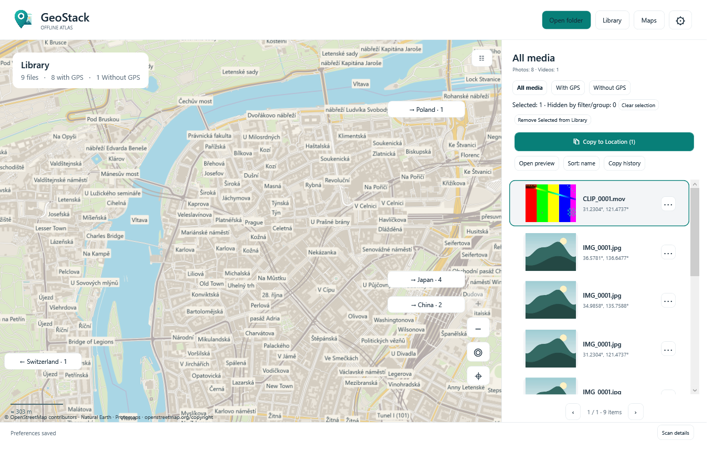

English | [Русский](README.ru.md)

# GeoStack

<!-- section:overview -->
## Offline geographic media library

GeoStack 0.5.5 is a portable Windows 11 x64 photo and video organizer built with C#, .NET 10 and WPF. Browse media on an offline map and organize selected files into country/city folders. English/Russian interfaces and System/Light/Dark themes are supported.

**This is a source-only publication proposal. No public Windows download is approved.** GeoStack-owned source is licensed under Apache-2.0, Copyright 2026 shinKatana0. The owner confirmed redistribution rights for original GeoStack branding; portable binary redistribution is separately blocked. See [LICENSE](LICENSE) and [NOTICE](NOTICE). See [release status](docs/REDISTRIBUTION_STATUS.md).

<!-- section:features -->
## Everyday use

- Open folders or drop files/folders from Explorer. Imports are additive and deduplicate source paths.
- Browse JPEG, HEIC/HEIF, supported RAW files and MOV/MP4 or other supported containers. Codec/content determines actual support; an extension is not a decode guarantee.
- Use Ctrl/Shift selection, Ctrl+A, GPS filters, double-click map navigation and F4 preview. Catalog removal preserves originals and persists exclusions.
- Geographic stacks and off-screen indicators keep distant locations accessible. Optional detailed maps complement the compact global atlas.
- Copy is the default. Copy preserves originals. Move removes sources only after a verified destination is committed; review uncertainty and destinations before confirming.

[Media Library](docs/MEDIA_LIBRARY.md) · [Copy/Move and recovery](docs/GEOGRAPHIC_ORGANIZATION.md)

<!-- section:privacy -->
## Offline operation and safety

Normal browsing is offline, without accounts or telemetry. Map downloads start only after explicit confirmation. Regional requests disclose the chosen area, not media, filenames, EXIF or individual photo-coordinate lists. Map detail and localized labels depend on actual coverage.

Keep independent backups. Move is deliberate and destructive after verified transfer; no arbitrary-filesystem or power-loss transaction guarantee is promised. Interrupted/partial operations require review. Never disable Windows protections to run an unsigned build.

[Offline maps](docs/OFFLINE_MAPS.md) · [Limitations](docs/KNOWN_LIMITATIONS.md) · [Security](SECURITY.md)

<!-- section:gallery -->
## Screenshots

These existing application-window captures use procedural scenery and synthetic GPS, not personal photographs. They show the accepted Windows application, not a new physical acceptance test. Optional Prague detail is not worldwide default coverage.

[Stacks, organization and downloads](docs/screenshots/README.md). Map attribution remains visible.

<!-- section:development -->
## Build, license and future work

See [BUILD](BUILD.md), [contribution guide](CONTRIBUTING.md), [changelog](CHANGELOG.md) and [third-party notices](THIRD_PARTY_NOTICES.md). No installer or system-wide .NET is needed for a self-contained portable build, but this source tree contains no native media-tool binaries. Building or obtaining dependencies does not authorize redistributing them.

No advertising, registration, paid tiers or mandatory cloud services. Android is a separate future milestone; [handoff](docs/ANDROID_HANDOFF.md) contains no Android implementation. Publication requires explicit owner approval.
