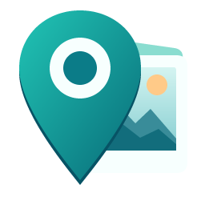
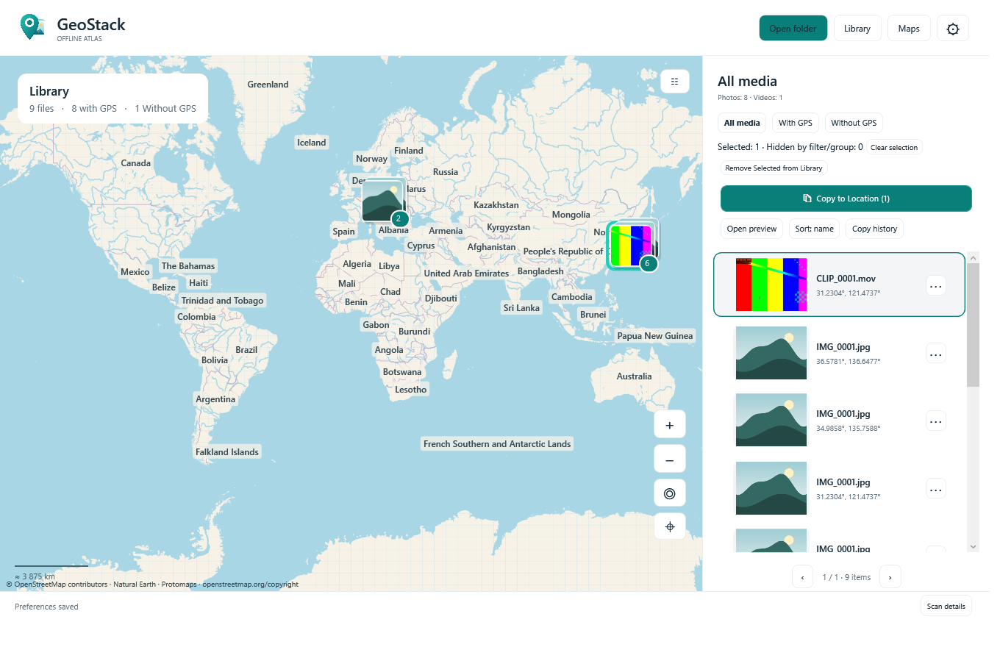
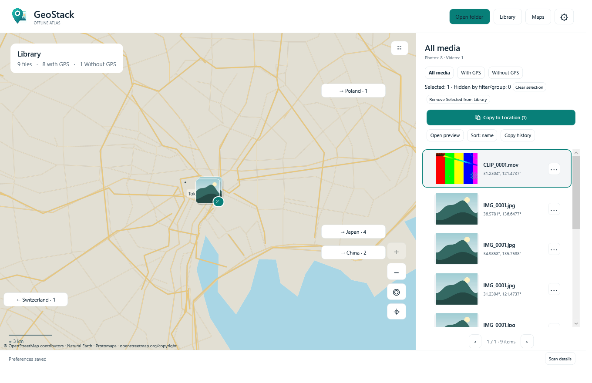
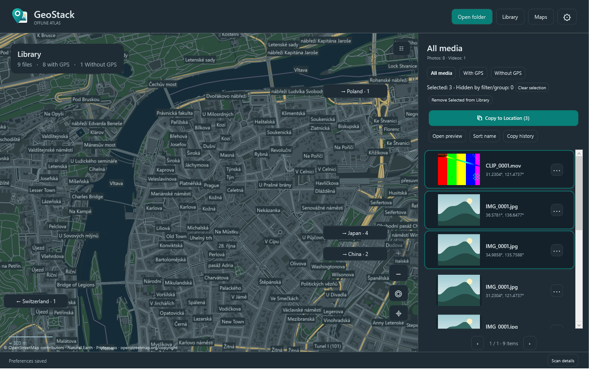
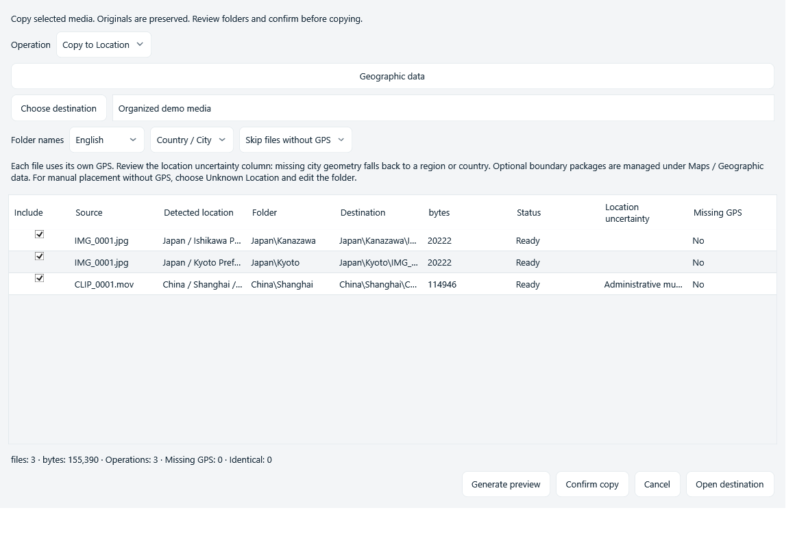

English | [Русский](README.ru.md)

# GeoStack



**An offline photo and video organizer for Windows.**

GeoStack puts your photos and videos on a map using the GPS information saved in each file. Browse a trip by place, view photos taken near one another, and copy or move selected files into country/city folders. Use JPEG, HEIC, supported RAW files and videos together, and download more detailed maps when you need them.

**The Windows 0.5.5 portable package is prepared for publication; the official download is pending.** [Installation and release materials](docs/WINDOWS_RELEASE.md).



*Photos grouped by place, with individual files in the Media Library. Screenshots use demonstration media.*

<!-- section:features -->
## What you can do

- **Add folders or individual files.** Open a folder or drag files from Explorer. New additions join your library; repeated imports do not add duplicates.
- **Browse by location.** Nearby photos share a stack on the map. Double-click a geotagged item to go to its location. Files without GPS stay available in the library.
- **Choose the files you need.** Filter by GPS, select with Ctrl or Shift, and preview with F4. Removing an item from the library leaves it on disk and keeps it out of folder rescans.
- **Organize files by place.** Preview country/city folders before copying or moving a selection. You can adjust uncertain locations instead of guessing where a file belongs.

The interface is available in English and Russian, with System, Light and Dark themes. Folder-naming language is a separate setting.

<!-- section:source -->
## Try it from source

GeoStack 0.5.5 uses C#, .NET 10 and WPF and runs on Windows 11 x64. Install the SDK selected in `global.json`, then run these commands from the repository root:

```powershell
. ./scripts/environment.ps1
dotnet restore GeoStack.sln --ignore-failed-sources -p:NuGetAudit=false
dotnet build GeoStack.sln -c Release --no-restore
```

The offline world atlas is included. Import and previews need separately supplied ExifTool and FFmpeg tools. [BUILD](BUILD.md) explains setup and launch with an isolated profile.

<!-- section:maps -->
## Maps for your library

The world map works offline. For more local detail, open **Maps → Download Detailed Maps for My Library**. Review the proposed areas, coverage and storage requirements, then choose what to download. Installed maps can be used offline afterward.

The built-in atlas is an overview, not a worldwide street map. Detail and translated place names depend on installed data. See [offline maps](docs/OFFLINE_MAPS.md).

<!-- section:formats -->
## Media formats

JPEG, HEIC/HEIF, supported RAW formats, MOV and MP4 can be browsed together. Preview support varies by camera format, codec and local media tools. See [Media Library and formats](docs/MEDIA_LIBRARY.md).

<!-- section:safety -->
## Your files and privacy

Normal browsing works offline, without accounts, telemetry or cloud uploads. Map downloads start only after confirmation. They request geographic areas, not your photos, filenames or individual photo-coordinate lists.

Copy preserves originals and is the default. Move is a separate choice: GeoStack checks the destination before removing the source file. Review the folders, keep backups and check interrupted operations before continuing. See [copy, move and recovery](docs/GEOGRAPHIC_ORGANIZATION.md).

<!-- section:gallery -->
## A closer look

<details>
<summary>Photo groups, detailed maps and folder previews</summary>



*A photo stack near Tokyo, shown with regional map context.*



*Downloaded city detail in Prague, using the Dark theme.*



*Preview country/city folders before copying, or select Move to Location.*

</details>

[More screenshots](docs/screenshots/README.md) · [Known limitations](docs/KNOWN_LIMITATIONS.md) · [Security](SECURITY.md)

<!-- section:license -->
## License and acknowledgments

GeoStack-owned source and original branding are licensed under [Apache-2.0](LICENSE), Copyright 2026 shinKatana0. Map data and other third-party material keep their own licenses; see [NOTICE](NOTICE) and [third-party notices](THIRD_PARTY_NOTICES.md). The atlas uses Natural Earth and OpenStreetMap-derived data through Protomaps.

[Contributing](CONTRIBUTING.md) · [Changelog](CHANGELOG.md) · [Architecture](ARCHITECTURE.md)
