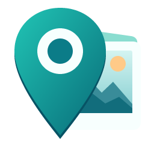
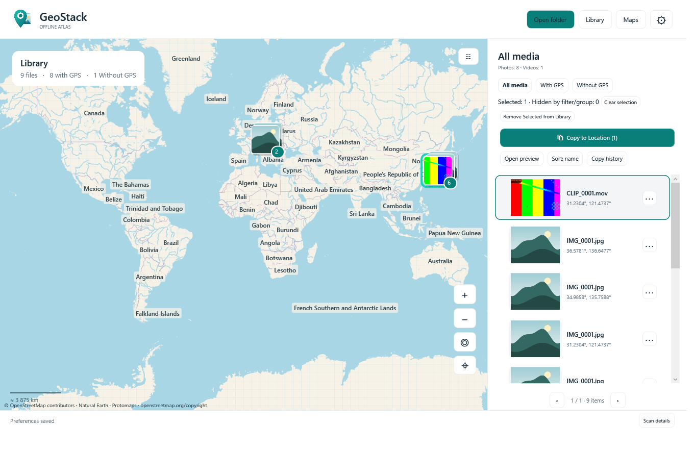
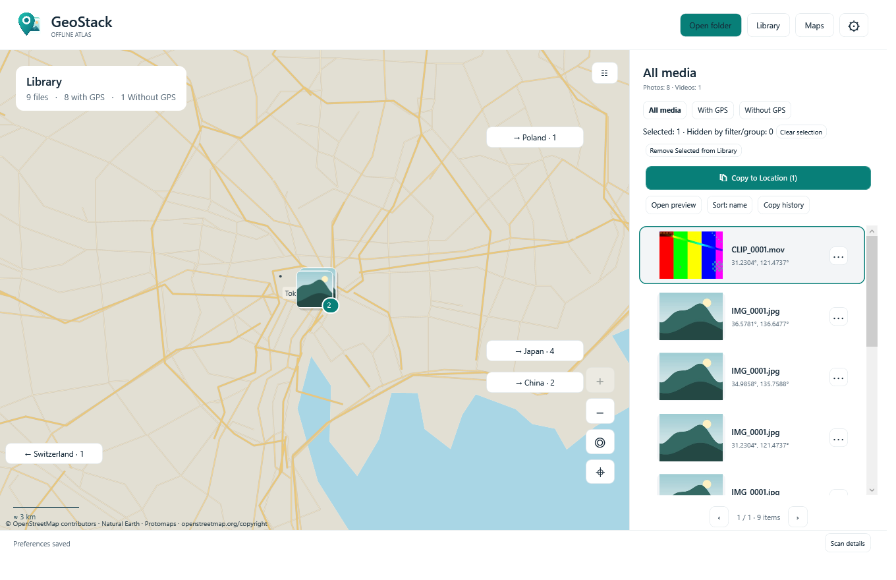
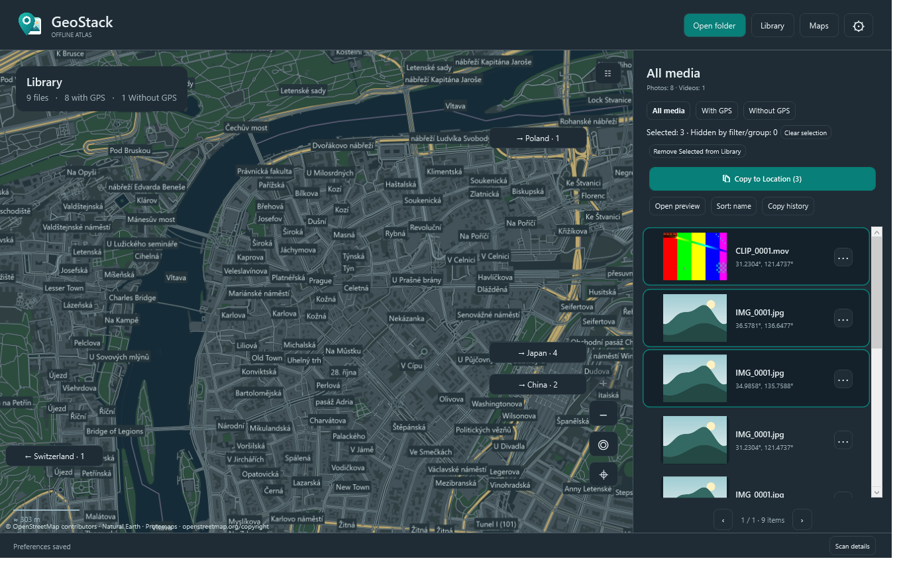
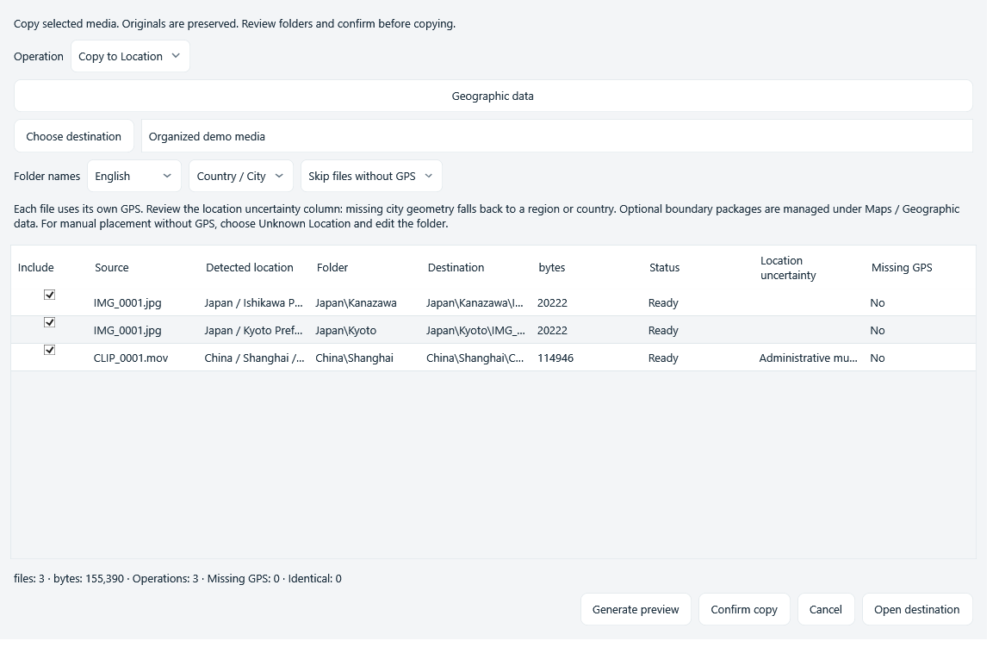

[English](README.md) | Русский

# GeoStack



**Офлайн-органайзер фотографий и видео для Windows.**

GeoStack показывает фотографии и видео на карте по GPS-координатам, сохранённым в файлах. Находите снимки из поездки по месту съёмки, просматривайте снимки, сделанные рядом, и копируйте или переносите выбранные файлы в папки по странам и городам. С JPEG, HEIC, поддерживаемыми RAW-файлами и видео можно работать в одной медиатеке, а при необходимости — загружать более подробные карты.

**Портативный пакет Windows 0.5.5 подготовлен к публикации; официальная загрузка ожидается.** [Установка и материалы выпуска](docs/WINDOWS_RELEASE.ru.md).



*На карте — группы фотографий по месту съёмки, в медиатеке — отдельные файлы. На снимках экрана показаны демонстрационные материалы.*

<!-- section:features -->
## Что умеет GeoStack

- **Добавляйте папки и отдельные файлы.** Откройте папку или перетащите файлы из Проводника. Они дополнят медиатеку; повторный импорт не создаст дубликатов.
- **Находите фотографии на карте.** Близкие по месту съёмки фотографии собираются в стопки. Двойной щелчок по файлу с GPS открывает его место на карте. Файлы без координат остаются в медиатеке.
- **Выбирайте нужные файлы.** Используйте фильтры GPS, выбирайте файлы с помощью Ctrl или Shift и открывайте просмотр клавишей F4. Удалённый из медиатеки файл останется на диске и не вернётся при повторном сканировании папки.
- **Раскладывайте файлы по месту съёмки.** Перед копированием или переносом проверьте папки стран и городов. Если место определено неточно, его можно исправить вручную.

Есть русский и английский интерфейсы, системная, светлая и тёмная темы. Язык названий папок выбирается отдельно.

<!-- section:source -->
## Как запустить из исходников

GeoStack 0.5.5 написан на C#, .NET 10 и WPF и работает в Windows 11 x64. Установите SDK, указанный в `global.json`, и выполните команды из корня репозитория:

```powershell
. ./scripts/environment.ps1
dotnet restore GeoStack.sln --ignore-failed-sources -p:NuGetAudit=false
dotnet build GeoStack.sln -c Release --no-restore
```

Офлайн-атлас мира уже включён. Для импорта и просмотра также нужны отдельно установленные ExifTool и FFmpeg. В [инструкции по сборке](BUILD.ru.md) описаны настройка и запуск с отдельным профилем.

<!-- section:maps -->
## Карты для вашей медиатеки

Карта мира работает без интернета. Если нужно больше подробностей, откройте **Карты → Скачать детальные карты для медиатеки**. Проверьте предложенные области, покрытие и необходимое место на диске, затем выберите карты для загрузки. После установки ими можно пользоваться офлайн.

Встроенный атлас даёт общее представление о местности, но не заменяет карту улиц всего мира. Детализация и язык подписей зависят от установленных данных. Подробнее — в разделе [«Офлайн-карты»](docs/OFFLINE_MAPS.ru.md).

<!-- section:formats -->
## Форматы файлов

JPEG, HEIC/HEIF, поддерживаемые RAW-форматы, MOV и MP4 можно просматривать в одной медиатеке. Поддержка превью зависит от формата камеры, кодека и установленных медиаинструментов. Подробнее — в разделе [«Медиатека и форматы»](docs/MEDIA_LIBRARY.ru.md).

<!-- section:safety -->
## Ваши файлы и конфиденциальность

Обычный просмотр работает офлайн: без учётных записей, телеметрии и отправки файлов в облако. Загрузка карт начинается только после подтверждения. Запрос содержит географическую область, а не фотографии, имена файлов или список координат отдельных снимков.

Копирование сохраняет оригиналы и используется по умолчанию. Перенос выбирается отдельно: GeoStack проверяет файл в папке назначения и только потом удаляет исходный. Проверяйте папки и храните резервные копии. Если операция прервалась, проверьте её результат перед продолжением. Подробнее — в разделе [«Копирование, перенос и восстановление»](docs/GEOGRAPHIC_ORGANIZATION.ru.md).

<!-- section:gallery -->
## Как это выглядит

<details>
<summary>Группы фотографий, подробные карты и выбор папок</summary>



*Стопка фотографий в районе Токио на региональной карте.*



*Загруженная подробная карта Праги в тёмной теме.*



*Проверьте папки стран и городов перед копированием или выберите перенос файлов.*

</details>

[Другие снимки экрана](docs/screenshots/README.ru.md) · [Известные ограничения](docs/KNOWN_LIMITATIONS.ru.md) · [Безопасность](SECURITY.ru.md)

<!-- section:license -->
## Лицензия и источники данных

Собственный код и оригинальная графика GeoStack распространяются по [Apache-2.0](LICENSE): Copyright 2026 shinKatana0. Карты и другие сторонние материалы сохраняют свои лицензии; см. [NOTICE](NOTICE) и [сторонние уведомления](THIRD_PARTY_NOTICES.ru.md). Атлас использует данные Natural Earth и данные OpenStreetMap, полученные через Protomaps.

[Участие в разработке](CONTRIBUTING.ru.md) · [История изменений](CHANGELOG.ru.md) · [Архитектура](ARCHITECTURE.ru.md)
