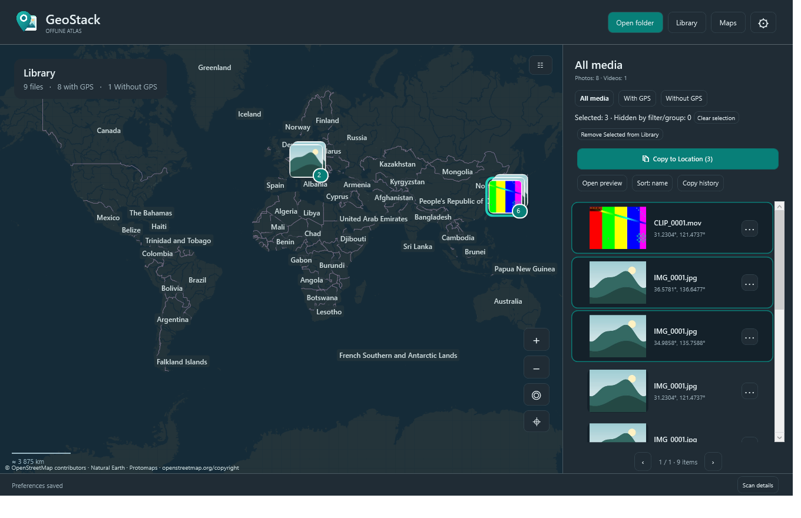

[English](README.md) | Русский

# GeoStack

<!-- section:overview -->
## Офлайн-медиатека на карте

GeoStack 0.5.5 — портативный органайзер фотографий и видео для Windows 11 x64, созданный на C#, .NET 10 и WPF. Просматривайте медиатеку на офлайн-карте и распределяйте выбранные файлы по папкам стран и городов. Доступны русский и английский интерфейсы, системная, светлая и тёмная темы.

**Это проект публикации исходного кода. Публичная загрузка Windows-сборки не одобрена.** Собственный код GeoStack распространяется по Apache-2.0: Copyright 2026 shinKatana0. Владелец подтвердил права на распространение оригинальной графики GeoStack; распространение бинарной сборки заблокировано отдельно. См. [LICENSE](LICENSE) и [NOTICE](NOTICE). См. [статус выпуска](docs/REDISTRIBUTION_STATUS.ru.md).

<!-- section:features -->
## Повседневная работа

- Открывайте папки или перетаскивайте файлы и папки из Проводника. Импорт дополняет медиатеку; повторное добавление того же пути не создаёт дубликатов.
- Просматривайте JPEG, HEIC/HEIF, поддерживаемые RAW-файлы и MOV/MP4 либо другие поддерживаемые контейнеры. Поддержка зависит от кодека и содержимого: расширение не гарантирует декодирование.
- Используйте Ctrl/Shift, Ctrl+A, фильтры GPS, переход по двойному щелчку и просмотр по F4. Удаление из каталога сохраняет оригиналы и постоянные исключения.
- Географические стопки и указатели за пределами экрана помогают находить удалённые места. Детальные карты дополняют компактный мировой атлас.
- По умолчанию выполняется копирование. Копирование сохраняет оригиналы. При переносе исходные файлы удаляются только после проверки и фиксации назначения; перед подтверждением проверьте неопределённые места и папки.

[Медиатека](docs/MEDIA_LIBRARY.ru.md) · [Копирование, перенос и восстановление](docs/GEOGRAPHIC_ORGANIZATION.ru.md)

<!-- section:privacy -->
## Офлайн-работа и безопасность

Обычный просмотр работает офлайн, без учётных записей и телеметрии. Загрузка карт начинается только после явного подтверждения. Запрос раскрывает выбранную область, но не медиафайлы, имена файлов, EXIF или список координат отдельных снимков. Детализация и язык подписей зависят от фактического покрытия.

Храните независимые резервные копии. Перенос намеренно удаляет исходные файлы после проверенного переноса данных; гарантия транзакции для любых файловых систем и сбоев питания не даётся. Прерванные и частично завершённые операции требуют проверки. Не отключайте защиту Windows ради неподписанной сборки.

[Офлайн-карты](docs/OFFLINE_MAPS.ru.md) · [Ограничения](docs/KNOWN_LIMITATIONS.ru.md) · [Безопасность](SECURITY.ru.md)

<!-- section:gallery -->
## Снимки интерфейса

Эти существующие снимки окна приложения используют процедурные изображения и синтетические GPS-координаты, а не личные фотографии. Они показывают принятую Windows-версию и не являются новым физическим приёмочным тестом. Детальная карта Праги — дополнительный пакет, а не стандартное покрытие всего мира.

[Стопки, организация файлов и загрузка карт](docs/screenshots/README.ru.md). Атрибуция карт сохранена.

<!-- section:development -->
## Сборка, лицензии и дальнейшая работа

См. [сборку](BUILD.ru.md), [руководство участника](CONTRIBUTING.ru.md), [историю изменений](CHANGELOG.ru.md) и [сторонние лицензии](THIRD_PARTY_NOTICES.ru.md). Самодостаточная портативная сборка не требует установщика или системной .NET, но в этом дереве исходников нет бинарных медиаинструментов. Сборка или получение зависимостей не разрешает их распространение.

Рекламы, регистрации, платных уровней и обязательных облачных сервисов нет. Android — отдельный будущий этап; [передача архитектуры](docs/ANDROID_HANDOFF.ru.md) не содержит реализации Android. Публикация требует явного одобрения владельца.
